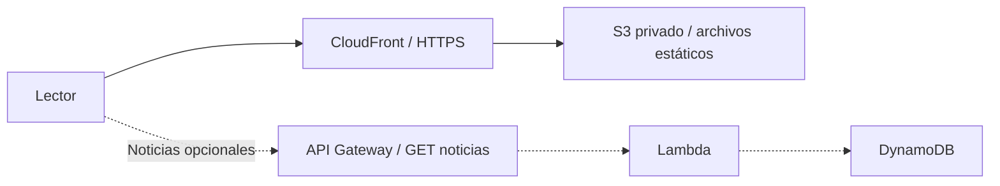

# La Gaceta — práctica universitaria

Gaceta de la **Universidad del Horizonte**, una institución ficticia. Usa únicamente HTML, CSS y JavaScript para la aplicación, sin frameworks, instalación de paquetes ni compilación. Todos los artículos y eventos son ejemplos.

## Ejecutar

Abre `index.html` en un navegador moderno. Para practicar la futura conexión HTTP, ejecuta desde esta carpeta:

```sh
python3 -m http.server 8000
```

Visita `http://localhost:8000`. Detén el servidor con `Ctrl+C`. Python solo sirve los archivos durante el desarrollo; no forma parte del sitio publicado.

## Funciones

- Portada editorial y seis artículos de ejemplo.
- Filtros por categoría y búsqueda por título, resumen o categoría, sin distinguir mayúsculas ni acentos.
- Lectura completa mediante un diálogo nativo, con cierre mediante botón o Escape.
- Noticias guardadas en `localStorage` y filtro para recuperarlas en el mismo navegador y origen. No se sincronizan entre dispositivos; si se bloquea el almacenamiento, los cambios duran solo la sesión y se informa al lector.
- Impresión del artículo abierto, mediante el diálogo del navegador; permite guardar como PDF si el navegador ofrece esa opción.
- Agenda y sección informativa. La agenda es demostrativa: no registra asistentes ni envía notificaciones.
- Fuente de noticias opcional por HTTPS, con validación de respuesta, tiempo máximo de ocho segundos y retorno a ejemplos si falla.

## Archivos y responsabilidades

| Archivo | Qué aprender o modificar |
| --- | --- |
| `index.html` | Estructura semántica, portada, agenda y diálogo de lectura. Cambia aquí el nombre de la universidad. |
| `styles.css` | Variables de color, tipografía, ilustración CSS, adaptación móvil e impresión. |
| `noticias.js` | Contenido ficticio y estructura de cada noticia. |
| `config.js` | URL pública opcional de la API. No contiene secretos. |
| `app.js` | Búsqueda, filtros, lectura, guardado y carga remota. |
| `tests/verificar.mjs` | Pruebas de comportamiento con Node.js y un DOM mínimo simulado. No se publica. |
| `VERIFICACION.md` | Criterios de diseño, pruebas realizadas y límites de revisión. |

## Diseño y skills

Se consultaron las skills locales `senior-frontend` y `code-reviewer` y sus referencias de buenas prácticas y revisión. Sus criterios se aplicaron a separación de responsabilidades, rendimiento, seguridad, adaptación y accesibilidad. Los analizadores incluidos en esas skills contienen lógica de ejemplo: **no se utilizaron como evidencia de validación**.

La dirección visual es editorial: títulos en Georgia, texto de lectura en Arial, papel crema y acentos vino. Son fuentes del sistema, por lo que no requieren descargas. La portada tiene una ilustración del campus realizada en CSS; los gráficos de las tarjetas son decorativos y están ocultos a lectores de pantalla.

El objetivo principal es encontrar y leer noticias. La jerarquía recorre portada, actualidad y agenda. En pantallas pequeñas la composición se convierte en una columna principal y la navegación permite desplazamiento horizontal. Se incluyen idioma español, enlace para saltar al contenido, foco visible, etiquetas de controles, estados `aria-pressed`, anuncios de resultados y reducción de movimiento. Estas medidas no constituyen una certificación de accesibilidad; las pruebas pendientes están en `VERIFICACION.md`.

## Preparación para Amazon Web Services

**El sitio no está desplegado y no se han creado recursos AWS.** Puedes publicar primero solo los cinco archivos públicos. No necesitas API ni base de datos para esta versión.



### 1. Publicación estática

1. Crea un bucket S3 y conserva el bloqueo de acceso público.
2. Sube a la raíz **solo** `index.html`, `styles.css`, `config.js`, `noticias.js` y `app.js`. No subas carpetas de configuración, documentación, pruebas o credenciales.
3. Crea una distribución CloudFront usando el origen normal de S3 y **Origin Access Control (OAC)**. Usa el origen S3, no el endpoint de alojamiento web de S3: OAC no funciona con ese endpoint.
4. Aplica al bucket la política que permite a esa distribución leer los objetos mediante OAC. Configura `index.html` como objeto raíz y redirección de HTTP a HTTPS.
5. Comprueba el sitio mediante la URL HTTPS de CloudFront. Un dominio propio es opcional.
6. Tras actualizar archivos con nombres sin versión, invalida en CloudFront los archivos modificados para no servir copias antiguas.

La configuración S3 privado + CloudFront OAC se apoya en la [documentación oficial de acceso al origen S3](https://docs.aws.amazon.com/AmazonCloudFront/latest/DeveloperGuide/private-content-restricting-access-to-s3.html). Los recursos pueden generar cargos: revisa su costo antes de crearlos y elimínalos al terminar la práctica si ya no los necesitas.

### 2. Noticias desde una API, opcional

Puedes implementar `GET /noticias` en API Gateway, integrarlo con Lambda y hacer que Lambda lea los artículos desde DynamoDB. Este backend es una fase posterior: **no está implementado en este repositorio**. [API Gateway HTTP APIs](https://docs.aws.amazon.com/apigateway/latest/developerguide/http-api.html) admite integración con Lambda y configuración CORS.

En `config.js`, cambia únicamente:

```js
window.GACETA_CONFIG = Object.freeze({
  newsEndpoint: 'https://TU_API.execute-api.TU_REGION.amazonaws.com/noticias'
});
```

La API debe devolver HTTP 200, `Content-Type: application/json` y un arreglo como este:

```json
[
  {
    "id": "laboratorio-01",
    "category": "Ciencia",
    "title": "Una nueva pregunta para el laboratorio",
    "date": "2026-10-09",
    "author": "Divulgación universitaria",
    "summary": "Un equipo presenta su proyecto estudiantil.",
    "body": ["Primer párrafo del artículo.", "Segundo párrafo del artículo."]
  }
]
```

Contrato: identificadores únicos; categorías `Academia`, `Ciencia`, `Cultura` o `Comunidad`; fecha real `YYYY-MM-DD`; campos de texto no vacíos de hasta 1,000 caracteres; cuerpo de 1 a 30 párrafos de hasta 10,000 caracteres cada uno; máximo 200 noticias. Un arreglo vacío representa una publicación sin noticias. La respuesta completa se rechaza si incumple el contrato. La API determina el orden de los artículos.

Configura CORS en la HTTP API para permitir el origen exacto de tu sitio y el método GET. Para desarrollo agrega `http://localhost:8000` si corresponde. El navegador omite credenciales. CORS no autentica ni autoriza: este contrato está pensado para **lectura de noticias públicas**.

Nunca coloques claves de AWS en JavaScript: cualquier visitante puede leerlo. Los permisos de DynamoDB pertenecen al rol de ejecución de Lambda, limitado a las operaciones necesarias. Un futuro panel de publicación necesitaría autenticación y autorización en el backend; no está incluido.

La portada, agenda e información institucional permanecen editoriales y locales. La API sustituye la lista de actualidad. Si eliminas noticias en la API, sus identificadores guardados pueden permanecer en el navegador, pero ya no aparecerán en la lista. Los guardados de la prueba local no se trasladan automáticamente al dominio de CloudFront.

## Verificar

Con Node.js instalado, sin instalar dependencias:

```sh
node --check app.js
node --check noticias.js
node --check config.js
node tests/verificar.mjs
```

Consulta `VERIFICACION.md` para distinguir comprobaciones realizadas de pruebas manuales pendientes.
